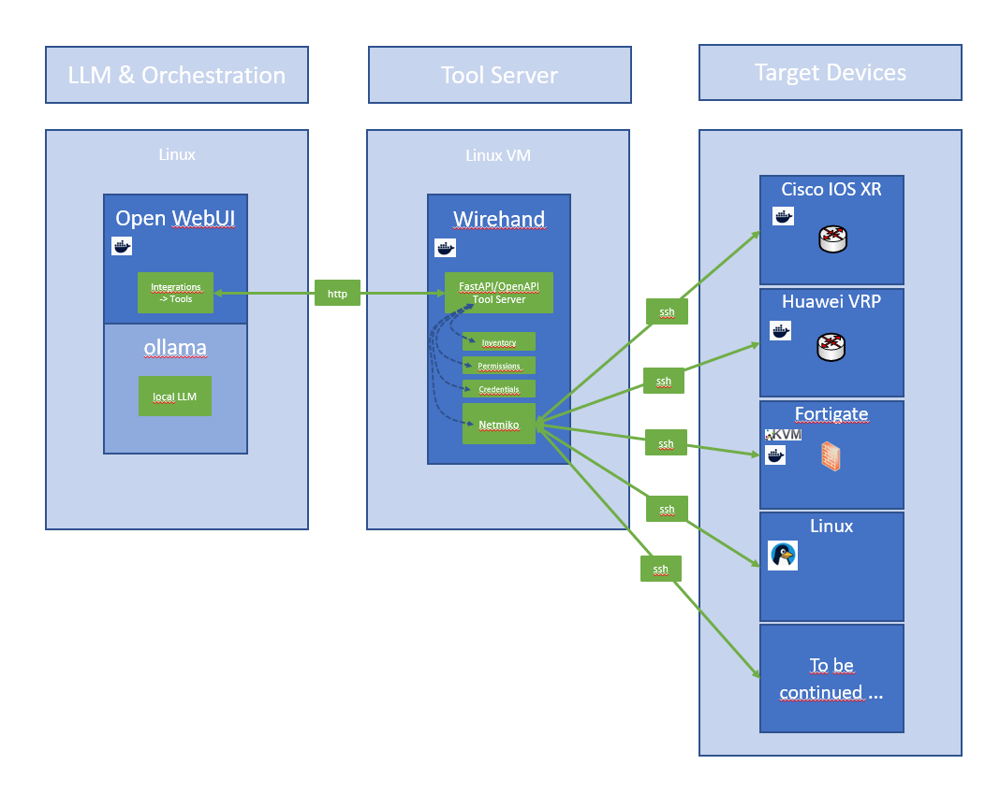

# wirehand

*A hand on the wires - with a glove on.*

**Version:** 0.6.1 · **License:** [Apache-2.0](LICENSE)

## Contents

- [Summary](#summary)
- [How it works](#how-it-works)
- [Key properties](#key-properties)
- [Installation](#installation)
- [Updating to a new version](#updating-to-a-new-version)
- [Configuration](#configuration)
- [Connecting the front-ends](#connecting-the-front-ends)
- [Where devices come from](#where-devices-come-from)
- [containerlab kind mapping](#containerlab-kind-mapping)
- [Reachability check and overlapping lab subnets](#reachability-check-and-overlapping-lab-subnets)
- [Platform behavior for changes](#platform-behavior-for-changes)
- [Approving changes](#approving-changes)
- [Timeouts and unknown outcomes](#timeouts-and-unknown-outcomes)
- [Audit log & snapshots](#audit-log--snapshots)
- [Troubleshooting](#troubleshooting)
- [Tests](#tests)
- [Design rules (why it looks the way it does)](#design-rules-why-it-looks-the-way-it-does)
- [License](#license)

## Summary

**wirehand** lets an LLM front-end such as Open WebUI or Onyx work on real network
devices and Linux servers over SSH. It can:

- run CLI commands to collect system status
- analyze the output
- apply configuration changes, with explicit human approval

wirehand works with devices that are listed in its inventory and reachable via SSH
from the host it runs on. Inventory entries come from a manual inventory file or from a
Containerlab auto-discovery feature.

wirehand is a small FastAPI service, shipped as a Docker container, that exposes a
handful of well-described tools via OpenAPI. Any front-end that can use an
"OpenAPI tool server" can use wirehand.

**Platform support**

wirehand uses [Netmiko](https://github.com/ktbyers/netmiko) for SSH, but only accepts
the device types it has platform logic for (facts bundles, commit/rollback handling):

| Status | `device_type` |
|---|---|
| Tested | `cisco_xr`, `huawei_vrpv8`, `fortinet`, `linux` |
| Implemented, not yet tested | `cisco_ios`, `cisco_xe`, `cisco_nxos`, `huawei`, `arista_eos`, `juniper_junos` |

Other Netmiko platforms are rejected when the inventory loads. Supporting one needs a
file in `config/platforms/` and its read-path rules in `config/safety/` - no Python, as
long as it applies changes the way one of the existing platforms does (see
"`config/platforms/`" under Configuration).

**Security by design**

- Credentials stay on the wirehand server; the LLM never sees them.
- Every change is staged, human-approved via a one-time TOTP code, snapshotted and
  audited. TOTP approval can be turned off globally or per device (e.g. for disposable
  lab nodes); see Configuration.

## How it works




1. **LLM & Orchestration:** the user chats in Open WebUI; the model (here a local LLM
   served by ollama) decides to call a wirehand tool, which Open WebUI sends over HTTP.
2. **Tool Server:** wirehand's FastAPI/OpenAPI server resolves the device name via the
   inventory, checks permissions (access level, read-only command rules), looks up the
   credentials server-side, and hands the commands to Netmiko.
3. **Target Devices:** Netmiko runs the commands over SSH on the device - lab nodes
   (containers or VMs) or physical/Linux hosts - and the output travels back as plain
   text to the chat.

### The tools, in the order a session uses them

| Tool | Type | What it does |
|---|---|---|
| `list_devices(refresh, check)` | read | Device names, platform, access level, CONFIRM (what applying a change needs: `totp` = authenticator code, `off` = chat approval, `-` = read-only), mgmt IP. `refresh=true` forces a rescan; `check=true` adds a STATE column (up / DOWN / `up?`) by TCP-probing each SSH port from the wirehand host. |
| `get_facts(device)` | read | One-call overview bundle (version, interfaces, routing summary, neighbors, recent log) - the intended first step of an analysis. |
| `run_read(device, commands, filter, context)` | read | Read-only commands. On network devices a blocklist plus argument-level checks; on **Linux devices an allow-list**: only known read-only commands run at all, everything else is refused (see "Key properties"). `device` accepts several names comma-separated. `filter` is a server-side case-insensitive regex; only matching lines (plus `context` surrounding lines) are returned - essential for running-configs and logs. |
| `propose_change(device, config, reason, mode)` | stage | Takes a snapshot, builds a preview, returns a 6-char code. **Applies nothing.** `mode='config'` (default) = configuration lines; `mode='exec'` = operational maintenance commands (reset, clear, process restarts) that must run in user/exec view - e.g. Huawei `reset ospf process 1`. |
| `confirm_change(code, approval)` | write | Applies the staged change: config mode + commit/save for `config`, plain exec for `exec` and for a staged `rollback`. Requires `access: rw` and - unless confirmation is switched off for that device - `approval`: the current 6-digit one-time code from the operator's authenticator app. See "Approving changes". |
| `rollback_change(device)` | stage | IOS-XR / VRPv8 / Junos: *stages* a native rollback of the last commit and returns a confirmation code - **undoes nothing** until `confirm_change`. Other platforms: touches nothing and returns the pre-change snapshot so a corrective change can be proposed. |
| `get_audit_log(device, n)` | read | The last `n` audit entries, optionally filtered by device. |

Output of every tool is plain text (small local models handle text much better than
JSON) and capped at ~20k tokens (`WIREHAND_MAX_OUTPUT_CHARS`); truncation is marked in the
output together with the hint to use `filter`.

## Key properties

- **Credentials never reach the LLM.** The model sees what `list_devices` returns: name,
  platform, access level, approval mode, management IP and description. Usernames,
  passwords, enable secrets and the TOTP secret stay server-side (inventory file +
  environment variables).
- **Reading is always safe.** `run_read` refuses write/privileged commands no matter what
  the model asks, in three layers: argument-level hard refusals (redirection, chaining,
  command substitution, `find -delete`, `awk 'BEGIN{system(...)}'`, `ethtool -s`,
  `journalctl --vacuum`, vendor shell escapes such as IOS-XR `run` or Junos `start shell`,
  and write-capable pipe modifiers such as `| file`, `| utility`, `| save`), then the write
  blocklist (configure, commit, rm, sudo, ...), then the allow-list - for every stage of a
  pipeline. On **Linux devices the allow-list is the last word**: what is not on it is refused. A blocklist can only name the
  commands somebody thought of, and on a shell that is never all of them - `touch`, `cp`,
  `ln -s` and `wget` are exactly the kind that used to slip through. Network CLIs keep the
  blocklist and allow unknown verbs: their exec view cannot start arbitrary programs, and
  vendor read verbs are far too varied to enumerate. All three layers are data, not code:
  they live in `config/safety/` - one file per device type plus a shared `common.yaml`
  (see "Configuration") - and are validated on load.
- **Every write is two-stage and human-gated.** `propose_change` and `rollback_change` only
  *stage* an operation and return a confirmation code. Codes are single-use and expire after
  10 minutes.
- **The approval is something the model cannot produce.** The staged code travels back
  through the model, so on its own it proves nothing - a model that decides to approve for
  you simply calls `confirm_change` with the code it was just handed, and small local models
  do exactly that. `confirm_change` therefore also wants a one-time code (TOTP) from the
  operator's authenticator app: valid ~30 seconds, consumed on first use, never visible to
  the model until a human types it into the chat. No system prompt can replace this - see
  "Approving changes".
- **Every tool call ends.** Each tool has an overall deadline (60 s by default). A
  `confirm_change` that runs out of time answers `OUTCOME UNKNOWN` instead of guessing,
  and a change command is never sent twice (see "Timeouts and unknown outcomes").
- **Everything is logged.** Every tool call lands in an append-only audit log; every
  proposed change first saves a configuration snapshot (see "Audit log & snapshots").

## Installation

Requirements: Docker + Compose on the machine that can reach your devices - for
containerlab that is the clab host itself.

### Quick start (git clone)

```bash
mkdir -p ~/docker && cd ~/docker
git clone https://github.com/stephan96/wirehand.git    # creates ~/docker/wirehand
cd wirehand

cp .env.example .env
cp config/inventory.yaml.example config/inventory.yaml
$EDITOR .env                    # at least WIREHAND_API_KEY and WIREHAND_CLAB_DIR
$EDITOR config/inventory.yaml   # replace the example device with your own (or remove it)
chmod 600 .env config/inventory.yaml

docker compose build --build-arg APP_UID=$(id -u) --build-arg APP_GID=$(id -g)
docker compose up -d
curl -H "Authorization: Bearer $(grep WIREHAND_API_KEY .env | cut -d= -f2)" \
     http://localhost:8110/list_devices
```

`.env` and `config/inventory.yaml` are listed in `.gitignore`, so a later `git pull`
never overwrites them. The read-path rules in `config/safety/` and the platform definitions
in `config/platforms/` need no copying - they ship ready to use, and
`docker exec wirehand python -m app.safety --lint` / `python -m app.platforms --lint` show
what is in force.

### Development install (tarball)

Use this when working with a local build that is not (yet) pushed to GitHub.

```bash
tar xzf wirehand-<version>.tar.gz -C ~/docker    # creates/overwrites ~/docker/wirehand
cd ~/docker/wirehand

cp .env.example .env
cp config/inventory.yaml.example config/inventory.yaml
$EDITOR .env                    # see "Configuration" below
$EDITOR config/inventory.yaml
chmod 600 .env config/inventory.yaml

docker compose build --build-arg APP_UID=$(id -u) --build-arg APP_GID=$(id -g)
docker compose up -d

# smoke test (replace the key):
curl -H "Authorization: Bearer $(grep WIREHAND_API_KEY .env | cut -d= -f2)" \
     http://localhost:8110/list_devices
docker logs wirehand | grep "device(s)"          # one line per discovered lab
```

**Why `--build-arg APP_UID/APP_GID`:** bind mounts keep host ownership. A file with mode
600 is only readable by its *owner*, so the user inside the container must have the same
uid as you on the host. The build args bake your uid/gid into the image. If you skip
this on a system where your uid is not 1000, the container dies with
`PermissionError: ... inventory.yaml`.

Do **not** pass them as a variable prefix (`UID=$(id -u) GID=$(id -g) docker compose ...`):
bash and zsh mark `UID` read-only. The shell prints `UID: readonly variable`, the build
then runs anyway and exits 0 with `UID` unset, compose falls back to the `${UID:-1000}`
default - and you get an image with uid 1000. `GID` is *not* read-only and does get
through, so the image ends up half right and the one-line error is easy to scroll past.

`--build-arg` works in every shell. If you prefer a one-liner, put `env` in front
(`env UID=$(id -u) GID=$(id -g) docker compose ...`): that sets the variables for the
child process instead of the shell. Note that `docker compose up --build` takes no
`--build-arg`, so building and starting are two commands.

**Why `network_mode: host`:** Docker isolates bridge networks from each other, so a
normally-bridged container cannot reach the containerlab management bridge
(172.20.20.0/24). Host networking sidesteps that; it also means port 8110 is bound
directly on the host and the local machine is reachable from inside the container as
`127.0.0.1`.

## Updating to a new version

Do **not** unpack the tarball *inside* `~/docker/wirehand` - the archive contains the
`wirehand/` folder as prefix and you would end up with a nested copy while building
the old code. Unpack in the parent (`~/docker`).

```bash
tar xzf wirehand-<version>.tar.gz -C ~/docker    # safe: .env and config/inventory.yaml are NOT in the archive (only *.example files)
cd ~/docker/wirehand
docker compose build --build-arg APP_UID=$(id -u) --build-arg APP_GID=$(id -g)
docker compose up -d
curl -s http://localhost:8110/openapi.json | grep -o '"version": *"[^"]*"'
```

**Upgrading to 0.5.0 needs one decision.** Changes now require a one-time approval code
by default, so `confirm_change` answers 503 until you either set `WIREHAND_TOTP_SECRET`
(`docker exec wirehand python -m app.approval --new`) or set `WIREHAND_CONFIRM_MODE=off`
to keep the old behaviour. Reading, proposing and staging keep working either way -
only the apply step is gated.

`curl -s http://localhost:8110/health` shows `confirm_mode` and `approval_ready`.

**Upgrading to 0.6.0:** every tool call now has an overall deadline of 60 s (see
"Timeouts and unknown outcomes"). What changes for existing setups:

- The front-end's tool timeout must be **longer than 60 s**, or it gives up before
  wirehand answers.
- `WIREHAND_CMD_TIMEOUT` defaults to 45 (was 60). If you set it to 60 or more, startup logs
  a warning, because the deadline then always cuts that step off first.
- New answers: HTTP 504 when a deadline runs out, HTTP 409 when a device is still busy
  with another call (nothing sent), and HTTP 502 `NOT CONFIRMED - OUTCOME UNKNOWN` when a
  change step fails after it was sent. Before, a failed exec/rollback command was retried
  once and could still be reported as `EXECUTED` / `ROLLED BACK`.


**Open WebUI caches the tool description: after an update, toggle the tool-server entry
off/on (or re-add it) so the model sees the new tool descriptions.**

## Configuration

### `.env` (next to docker-compose.yml, chmod 600)

```bash
WIREHAND_API_KEY=change-me-long-random-string
WIREHAND_CONFIRM_MODE=totp                    # totp (default) | off - see "Approving changes"
WIREHAND_TOTP_SECRET=JBSWY3DPEHPK3PXP...      # docker exec wirehand python -m app.approval --new
WIREHAND_APPROVAL_MAX_AGE=120                 # seconds a code stays valid after the app moves on
WIREHAND_CLAB_DIR=/path/to/containerlabs       # host path with your labs
UBUNTU_USER=netops                           # credentials referenced from inventory.yaml
UBUNTU_PASS=...
```

Dotenv rules that bite in practice: no spaces around `=`, no `export`, and everything
after `#` counts as a comment - a password containing `#` gets silently cut. Avoid
`$ # " ' \ `` ` `` in values (the same file is used by Compose for interpolation). If the
container reports `env var 'X' which is not set` although you set it, check with
`docker compose config | grep X` what actually arrives, and remember that `.env` changes
need `docker compose up -d` (a plain `restart` does not reread it).

### `config/inventory.yaml`

```yaml
devices:                       # manual devices; {} if you only use containerlab
  UBUNTU:
    host: 127.0.0.1            # the clab host itself, via host networking
    device_type: linux
    username: env:UBUNTU_USER # env:VAR -> resolved from the container environment
    password: env:UBUNTU_PASS
    access: ro                 # ro (default) | rw; start ro, lift deliberately
    confirm: totp              # totp | off - overrides WIREHAND_CONFIRM_MODE for this device
    description: containerlab host
    tags: [host, linux]

containerlab:                  # defaults for every *discovered* lab node
  default_access: rw           # ro | rw for discovered nodes; labs are disposable
  default_confirm: off         # totp | off for discovered nodes - the global
                               #   WIREHAND_CONFIRM_MODE applies when omitted
  long_names: false            # true -> full names like clab-xrd-test-xrd1
  kinds:                       # per-kind overrides; beat the two defaults above
    huawei_vrp: { device_type: huawei_vrpv8 }   # NE40E/CE = VRP8; 'huawei' for VRP5 images
    cisco_xrd: { access: rw, confirm: off }     # device_type | access | confirm
  credentials:                 # for kinds whose generated inventory has no password
    fortinet_fortigate: { username: admin, password: env:FGT_PASS }
```

Discovered nodes get no `confirm:` of their own - they are not in this file - so
`containerlab.default_confirm` (or `kinds.<kind>.confirm`) is the only place to set it
for them. A node listed under `devices:` is a manual device and uses its own `confirm:`.

`config/inventory.yaml.example` ships the same structure with every key spelled out,
including the ones the example above leaves at their default.

### Every key a device accepts

| Key | Default | Meaning |
|---|---|---|
| `host` | *required* | IP or hostname; resolved inside the container |
| `device_type` | *required* | Netmiko driver, see the list below |
| `username` | *required* | the account the LLM effectively works as |
| `password` | - | SSH password |
| `secret` | - | enable password; used on `cisco_ios`, `cisco_xe`, `cisco_nxos`, `arista_eos` |
| `port` | `22` | SSH port |
| `timeout` | `30` | passed to Netmiko as `timeout`; over SSH it has practically no effect (see below) |
| `access` | `ro` | `ro` \| `rw` - whether the device may be changed at all |
| `confirm` | `WIREHAND_CONFIRM_MODE` | `totp` \| `off` - who may approve a change |
| `description` | `""` | free text, shown to the model |
| `tags` | `[]` | free-form labels, shown to the model |

`device_type` is the Netmiko driver: `linux`, `cisco_ios`, `cisco_xe`, `cisco_xr`,
`cisco_nxos`, `huawei`, `huawei_vrpv8`, `fortinet`, `arista_eos`, `juniper_junos`.

`env:VARNAME` works for `username`, `password` and `secret`.

`timeout` does **not** limit how long a command may take. wirehand gives every command an
explicit Netmiko `read_timeout` (`WIREHAND_CMD_TIMEOUT` / `WIREHAND_CHANGE_CMD_TIMEOUT`),
which takes precedence, and the SSH connect has its own fixed limits (15 s TCP connect,
30 s banner). Netmiko 4 uses `timeout` only for telnet and its old delay-factor mode,
neither of which wirehand uses. The key is accepted so existing inventories still load.
There are no per-device deadlines; see "Timeouts and unknown outcomes".

`secret` is only consulted on platforms whose `config/platforms/` file sets
`session.enable: true` (`cisco_ios`, `cisco_xe`, `cisco_nxos`, `arista_eos`) - it triggers
Netmiko's `enable()` when a session opens. On a device whose account already lands in privileged mode, leave
it out.

Unknown keys are refused rather than ignored, so a typo like `passwrod:` fails the load
instead of silently producing a device without a password. The error names the device, the
key it choked on and the keys that do exist:

```
device 'core-sw1': unknown key(s) passwrod. Known keys: access, confirm, description,
device_type, host, password, port, secret, tags, timeout, username
```

A missing `host`, `device_type` or `username` fails the same way.

Missing `env:` variables fail the whole inventory load at startup - deliberately
(fail-fast beats a device with half-empty credentials). Remove dead references.

### Access levels and Linux accounts

`access: ro` allows `get_facts`/`run_read` only; `rw` additionally allows
propose/confirm/rollback (config **and** exec mode - a rollback is staged and confirmed
like any other change). `rw` decides *whether* a device can be changed, `confirm:` decides
*who may approve* it (see "Approving changes"). Recommended path: everything `ro`,
lift devices to `rw` one at a time, first write test on a disposable lab node.

For Linux devices, the SSH account is what the LLM gets: the read path can `cat`
anything that account can read. Use a dedicated low-privilege user rather than your
personal account, and grant targeted passwordless sudo only for commands you expect in
changes. The read path never escalates (`sudo` is refused there) and runs allow-listed
read commands only - but an allow-listed `cat` still reads every file the account can
read, so the account, not the allow-list, is what bounds exposure.

### `config/safety/` - read-path rules per device type

The lists that decide what `run_read` may execute live in this directory, not in the
code, so they can be reviewed and extended without touching Python. There is one file per
supported `device_type` - the same name you write in `inventory.yaml` - plus one file that
applies to all of them:

| File | Applies to |
| --- | --- |
| `common.yaml` | every device: redirection and chaining in any spelling (`>`, `;`, `&`, `\|\|`), command and process substitution, piping into an interpreter, write-capable pipe modifiers (`\| file`, `\| save`, ...), interpreters (`bash`, `python`, `tclsh`), `ssh`/`telnet`/`curl` |
| `linux.yaml` | `linux` - deny by default, with the full Linux allow-list |
| `cisco_ios.yaml`, `cisco_xe.yaml`, `cisco_xr.yaml`, `cisco_nxos.yaml` | the Cisco platforms, each with its own shell escapes (`run`, `guestshell`, `event manager`) |
| `huawei.yaml`, `huawei_vrpv8.yaml` | Huawei VRP5 / VRP8 (`system-view`/`sys`, `undo`, `save`, `reset`) |
| `fortinet.yaml` | FortiGate (`config`, `execute`, `diagnose ... kill/clear`, `sudo`, `fnsysctl`) |
| `arista_eos.yaml`, `juniper_junos.yaml` | Arista EOS, Junos (`start shell`, `request`, `restart`, op-mode `set`/`file`) |
| `local/<name>.yaml` | optional, your own additions - see below |

A device of type `cisco_xr` is checked against `common.yaml` + `cisco_xr.yaml` (+
`local/common.yaml` + `local/cisco_xr.yaml` if present), so a rule in `cisco_xr.yaml`
never affects a Huawei or a Linux box. Every file has the same three sections, evaluated
in a fixed order that the files cannot change; a device file also sets the default:

| Key | What it holds | On a match |
| --- | --- | --- |
| `hard_refusals` | argument-level checks: `find -delete`, `ethtool -s`, vendor shell escapes, ... | refused, with that entry's `reason` - wins even over an allow-listed verb |
| `blocklist` | known write/privileged verbs, grouped (`package-managers`, `config-mode-and-commit`, ...) | refused |
| `allowlist` | known-good read verbs, grouped (`networking`, `read-verbs`, ...) | allowed |
| `default` (device files only) | `deny` or `allow` | what happens to a command that matches nothing |

**A pipeline is checked stage by stage**, each stage like a command of its own:
`cat x | crontab -` is refused on Linux because `crontab` is not on the allow-list - the
allowed `cat` in front does not carry it through. The split follows shell quoting, so
`grep -E 'a|b' file` stays one stage. On a network CLI the stages are pipe modifiers
(`| include`, `| match`), which the device files list in an allow-list group of their own.

**Network CLIs accept abbreviations** - `config t`, `sys`, `exe reboot`, `wr` - so the
vendor files write a write verb as its shortest distinctive prefix plus `[a-z]*`
(`'^con[a-z]*(\s|$)'`) rather than the full word. Keep that in mind when you add one.

`linux` ships with `default: deny`: nothing runs there unless the allow-list names it. The
network platforms ship with `default: allow`, because their exec view cannot start
arbitrary programs - on them the allow-list only documents the read verbs. Switching a
platform to `default: deny` makes it allow-list only, so extend its `allowlist` first.

Each entry is a Python regular expression, matched with `re.search` against the command
after whitespace collapse, case-insensitively unless the entry sets `case_sensitive: true`
(which is how `ethtool -S` stays readable while `ethtool -s` is refused). Within a section
the order of entries does not matter. Always single-quote a pattern so YAML keeps the
backslashes:

```yaml
# config/safety/linux.yaml
blocklist:
  - group: package-managers
    patterns:
      - '^(apt|apt-get|dnf|yum|pip|pip3|snap|apk)\s+(install|remove|purge|upgrade|autoremove|add|del|fix)'

allowlist:
  - group: networking
    patterns:
      - '^(ss|netstat|arp|traceroute)(\s|$)'    # (\s|$) also matches the bare verb
      - '^(ethtool)(\s|$)'                      # '\s' alone would require an argument
```

Check the rules before they go live, and after every edit. `--explain` answers "why was
this refused?" by naming the file, the entry and the reason:

```bash
docker exec wirehand python -m app.safety --lint      # or: python -m app.safety --lint config/safety
docker exec wirehand python -m app.safety --explain huawei_vrpv8 'system-view'
#   huawei_vrpv8: 'system-view'
#     REFUSED by hard_refusals in huawei_vrpv8.yaml
#     pattern: '^system-view\b'
#     reason:  vendor config view - use propose_change
```

Edits are picked up within `WIREHAND_SAFETY_RESCAN` seconds (30 by default);
`list_devices(refresh=true)` applies them at once. The rules are **fail-closed**: if any
file is unparseable, has an unknown key, a missing section or an uncompilable regex - or
if a supported `device_type` has no file of its own - nothing is loaded. On startup that
aborts the container (`docker logs wirehand` names the file and the offending entry); at
runtime the rules already in memory keep serving and the error is logged, so a typo can
never widen the read path.

Two things to keep in mind when editing:

- **These files are security policy.** Whoever can write them can grant arbitrary command
  execution on the read path. They are mounted read-only into the container; keep them
  owned by the admin account and out of reach of the service user.
- **Adding a verb to `linux.yaml`'s `allowlist` grants it on every Linux device.** Check
  that none of its *arguments* can write - that is what `hard_refusals` is for. The
  pattern matches the verb, so `find` on the allow-list is what made `find ... -delete`
  necessary as a hard refusal.

#### Local additions: `config/safety/local/`

The shipped files are version-controlled and get improved between versions, so a
`git pull` replaces them. Put your own rules in `config/safety/local/<name>.yaml` instead,
where `<name>` is `common` or a `device_type`. That directory is in `.gitignore` and not
part of a release, so updates leave it alone:

```yaml
# config/safety/local/linux.yaml - only the sections you need
allowlist:
  - group: site-tools
    patterns:
      - '^(jq)(\s|$)'

hard_refusals:
  - pattern: '^cat\s+/etc/app/secrets'
    reason: application secrets are off limits on the read path
```

A local file can only **add** entries to its device type (or to every type, for
`local/common.yaml`): it cannot remove a shipped rule and cannot set `default`. A file
whose name is not `common` or a supported `device_type` is refused rather than ignored,
so a typo such as `cisco-xr.yaml` shows up in `--lint` instead of silently not applying.
After an update, `--lint` plus `python -m pytest tests/test_safety.py` tells you whether
the result is sound.

### `config/platforms/` - how wirehand works with each device type

Everything wirehand does differently per platform - apart from the read-path rules - is
described here, again one file per supported `device_type` plus a `common.yaml`. **The set
of files is the list of supported device types:** a `device_type` without a file is
rejected when the inventory loads, and every file needs its counterpart in
`config/safety/` (and the other way round).

| Key | What it decides |
| --- | --- |
| `facts` | the commands `get_facts` runs |
| `snapshot` | the command whose output is saved before every change (`null` on Linux) |
| `session.enable` | call `enable()` when the device has a `secret` |
| `session.prep` | commands sent once when a session opens (Huawei: `mmi-mode enable`) |
| `change.apply` | `config_set` (Netmiko config mode) or `shell` (each line is a command) |
| `change.finish` | after `config_set`: `commit`, `save`, or `none` (FortiOS blocks close themselves) |
| `change.rollback_last` | native rollback of the last commit, or `null` (snapshot only) |
| `change.balance_end` | append missing `end` lines to open `config` blocks (FortiOS) |
| `change.drop_trailing` | trailing lines dropped from a config change (`end`, `return`, `exit`) - the tool leaves config mode itself, and the preview names what was dropped |
| `change.last_line_only` | lines that are dropped at the end like `drop_trailing`, but refused anywhere else (`end`, `return`: in the middle they leave config mode with the change uncommitted) |
| `change.refuse_in_config` | lines a config change must not contain (they leave config mode, commit or reboot), with the reason shown to the model |
| `prompts` | device questions and the answers to them; shared ones in `common.yaml` |
| `comment_prefixes` | lines of a proposed change that are dropped as comments (`#`, `!`) |
| `containerlab.kinds` | the containerlab kinds that map to this `device_type`, with their default credentials |

`refuse_in_config` is matched against every line of a config-mode change. CLIs accept
abbreviations, so a verb is written as its shortest distinctive prefix plus `[a-z]*` (`wr`
is `write`), and `(\s|$)` keeps config words that only start the same way
(`config-register`, `end-policy`, `sysname`) out of it. What is refused runs something
from inside a config change (`do`, `run`, `copy`, `execute`) or commits/saves in the middle
of it; merely leaving a mode (`end`, `exit`, `quit`, `return`) is allowed.

`extends: cisco_ios` lets a file start from another one and override only what differs
(that is all `cisco_xe.yaml` does). `change.apply` and `change.finish` name behaviours that
are implemented in code - a new platform that fits one of them needs no Python; one that
does not (a different commit dialogue, say) needs a code change first.

```yaml
# config/platforms/huawei_vrpv8.yaml (abridged)
version: 1
name: Huawei VRP8
facts: [display version, display ip interface brief, display bgp peer]
snapshot: display current-configuration
session:
  prep: [mmi-mode enable]
change:
  apply: config_set
  finish: commit
  rollback_last: [rollback configuration last 1]
  refuse_in_config:
    reason: the tool enters and leaves system-view and commits/saves itself, ...
    patterns:
      - '^run(\s|$)'                  # 'run <cmd>' runs a user-view command from system-view
      - '^com(m(it?)?)?(\s|$)'        # commit
containerlab:
  kinds:
    huawei_vrp: {username: admin, password: admin}
```

The files are read **once, at startup** - unlike the safety rules, they decide how pooled
sessions are opened and changes committed, so an edit takes effect with
`docker compose restart wirehand`. They are fail-closed in the same way: an unknown key, a
missing required key, an uncompilable regex, a file name that is not a Netmiko driver, a
containerlab kind claimed by two files or a contradiction (a native rollback on a platform
without commits) stops the container, and the log names file and key. Check before
restarting:

```bash
docker exec wirehand python -m app.platforms --lint   # or: python -m app.platforms --lint config/platforms
```

Quote prompt answers and reasons that look like booleans (`'Y'`, `'yes'`, `'no'`) - YAML
reads a bare `yes`/`no` as true/false, and the loader refuses that rather than guess.

## Connecting the front-ends

### Open WebUI

Admin -> Settings -> **External Tools** -> add: URL `http://<clab-host>:8110`, Auth
Bearer, key = `WIREHAND_API_KEY`. Note that Open WebUI's *browser* talks to the tool
server directly: the URL must be reachable from your workstation, and CORS is handled by
the tool (`WIREHAND_CORS_ORIGINS`, default `*`). The known Save-button issue on LAN-HTTP
applies (workaround: SSH tunnel to localhost:3000).

Per chat: enable the tool and use **Native** function calling. Recommended: a dedicated
"wirehand" model preset (num_ctx 32k, `ENABLE_KB_EXEC` off for that model) with this
system prompt:

> You operate network devices and Linux servers only through the wirehand tools. Use
> device names exactly as shown by list_devices. Start broad analyses with get_facts;
> for specific questions call run_read directly, and for long outputs always pass a
> filter regex. Never claim a command ran unless you called a tool; base all findings
> on tool output only. On AUTHENTICATION FAILED, report it and stop for that device; if
> the user says the credentials are fixed, call list_devices(refresh=true) and try
> again. Changes: call propose_change, show the user the preview and the code, then
> stop and wait for explicit approval; only then call confirm_change with that exact
> code. Maintenance commands (reset, clear, process restarts) go through propose_change
> with mode='exec', never run_read. If unsure about platform CLI syntax, verify it via
> web search before proposing a change.

**Tool timeout:** every wirehand tool answers within 60 s (its deadline, see "Timeouts
and unknown outcomes") plus a little overhead. The front-end's own timeout for tool calls
must be **longer** than that, e.g. 90 s. If it is shorter, the front-end gives up first:
the model never sees the `504 OUTCOME UNKNOWN`, and may report a change as failed or
retry it while it is still running. Check this in Open WebUI and Onyx whenever you raise
a `WIREHAND_DEADLINE_*` value.


#### Extended prompt: forgotten tool switch

The tool switch is per chat. When it is off, the wirehand tools are simply absent from
the model's schema - and a model that still feels obliged to answer a device question
will invent device names and command output instead of saying so. The following
extended prompt adds an availability rule that turns that silent failure into a visible
message. Same text as above, with the middle paragraph added:

> You operate network devices and Linux servers only through the wirehand tools. Use
> device names exactly as shown by list_devices. Start broad analyses with get_facts;
> for specific questions call run_read directly, and for long outputs always pass a
> filter regex. Never claim a command ran unless you called a tool; base all findings
> on tool output only. On AUTHENTICATION FAILED, report it and stop for that device; if
> the user says the credentials are fixed, call list_devices(refresh=true) and try
> again.
>
> Tool availability: the wirehand tools (list_devices, get_facts, run_read,
> propose_change, confirm_change, rollback_change, get_audit_log) are only present when
> the wirehand tool server is enabled for this chat. If a request requires one of them
> and it is not among your available tools, do NOT answer from your own knowledge, do
> not guess device names, inventory contents or command output, and do not describe
> what you would have run. Reply only with a short note, in the user's language, saying
> that the wirehand tool is not active in this chat and that it has to be enabled (chat
> controls / tool selector, Native function calling). This applies only to wirehand -
> questions that need no device access (concepts, CLI syntax, planning) are answered
> normally.
>
> Changes: call propose_change, show the user the preview and the code, then stop and
> wait for explicit approval; only then call confirm_change with that exact code. The
> same applies to rollback_change: it only stages the undo and returns a code, so show
> it, wait for approval, then call confirm_change. If the tool answer asks for an
> approval code, the user has to read a 6-digit number from their authenticator app:
> ask for it in plain words and wait for their reply. Never put a number there that
> the user did not just send you - you cannot compute it, an old one will not work,
> and a wrong one is logged as a failed approval.
> Maintenance commands (reset, clear, process restarts) go through propose_change with
> mode='exec', never run_read. If unsure about platform CLI syntax, verify it via web
> search before proposing a change.

Put this on the model preset, not in the global system prompt: in chats that have
nothing to do with wirehand the rule would fire on unrelated questions. Keep
`ENABLE_KB_EXEC` off for the preset - otherwise the model still sees a "run commands"
tool and considers the condition satisfied.

This is a prompt heuristic, not an enforced check: the model cannot ask *why* a tool is
missing, it only sees a reduced schema. Small local models (<= 8B) are exactly the ones
that keep hallucinating here, and Legacy function calling injects tools differently, so
the rule is unreliable there. Verify with prompts 17 and 18 of `tests/toolcall_suite.md`
after every model change.

### Onyx

Admin -> **Actions** -> Add -> OpenAPI schema: fetch `http://<clab-host>:8110/openapi.json`,
auth header `Authorization: Bearer <key>`, attach the action to an Agent. If Onyx runs in
Docker on another host, its `api_server` and `background` containers need
`extra_hosts: ["host.docker.internal:host-gateway"]` to resolve host-mapped services.

## Where devices come from

Two sources, merged at runtime; both can be used at the same time:

1. **containerlab auto-discovery.** Point `WIREHAND_CLAB_DIR` at the folder that holds your
   containerlab topologies (e.g. `/home/<user>/containerlabs`). For every *deployed* lab,
   containerlab generates a `clab-<lab>/ansible-inventory.yml` with node kind, management
   IP and default credentials - wirehand scans these recursively. Nodes appear under
   the name `<lab>-<node>` (e.g. `xrd-test-xrd1`) and disappear automatically when the lab
   is destroyed, because destroying a lab removes the generated folder.
2. **Manual entries** in `config/inventory.yaml` under `devices:` - for anything that is
   not a lab node (the containerlab host itself, physical routers, servers). A manual
   entry with the same name as a discovered node overrides it, which is also the way to
   pin different credentials or a different access level for a single lab node.

Both sources are re-checked every 30 s (`WIREHAND_CLAB_RESCAN`) using file modification
times, so deploying/destroying a lab or editing `inventory.yaml` shows up without a
restart. To force an immediate reload, ask the model to call `list_devices` with
`refresh=true`. Only `.env` changes require a container recreate (`docker compose up -d`),
because environment variables are fixed when a container starts - that is a Docker
property, not a tool limitation.

The file `config/inventory.yaml` is **never written by the tool** - it is your file, and
it is mounted read-only into the container.

## containerlab kind mapping

Shipped in the `containerlab.kinds` of `config/platforms/*.yaml`:

| clab kind | Netmiko driver | default creds |
|---|---|---|
| cisco_xrd, cisco_xrv9k | cisco_xr | clab / clab@123 |
| cisco_iol | cisco_ios | admin / admin |
| cisco_csr1000v, c8000v, cat9kv | cisco_xe | - |
| cisco_n9kv | cisco_nxos | - |
| huawei_vrp | huawei_vrpv8 | admin / admin |
| fortinet_fortigate | fortinet | admin / admin |
| arista_ceos / veos | arista_eos | admin / admin |
| juniper_vjunos*, vmx, vsrx | juniper_junos | - |
| linux, sonic-vs, generic_vm | linux | clab / clab@123 |

Precedence: `containerlab.credentials` in inventory.yaml > generated
`ansible_user`/`ansible_password` > the defaults above; `containerlab.kinds` in
inventory.yaml can map a kind to a different driver. Unmapped kinds are
skipped with a log line (`docker logs wirehand`).

## Reachability check and overlapping lab subnets

`list_devices(check=true)` opens a TCP connection to each device's SSH port (2 s timeout,
`WIREHAND_CHECK_TIMEOUT`, all devices in parallel). It verifies the network path and a
listening sshd - **not** credentials: a device can show `up` and still fail the login.

containerlab puts every lab on the same default management subnet (`172.20.20.0/24`)
unless told otherwise, so two labs can legitimately contain the same management IP - and
stale `clab-*` folders from labs destroyed without `--cleanup` keep such entries alive in
discovery. A TCP probe cannot tell which lab answered. wirehand therefore marks every
device whose management IP is shared with another device as `up?` and appends a warning
naming the colliding entries.

To get unambiguous results, give each lab its own subnet in its `.clab.yml`:

```yaml
mgmt:
  network: clab-<labname>
  ipv4-subnet: 172.20.30.0/24      # one distinct /24 per lab
```

and destroy unused labs with `--cleanup` so their generated folders disappear.

## Platform behavior for changes

Set per device type by `change.*` in `config/platforms/`:

| device_type | Change path | Rollback |
|---|---|---|
| cisco_xr, huawei_vrpv8, junos | config-set + commit | native (`rollback configuration last 1`), staged + confirmed; VRP needs `mmi-mode` (see below) |
| cisco_ios/xe/nxos, arista_eos, huawei (VRP5) | config-set + save | snapshot only -> corrective change |
| fortinet | config-set (persists immediately) | snapshot only |
| linux | commands run sequentially as the login user | none - include backups in the change (`sudo cp x x.bak`) |

`mode='exec'` runs in user/exec view on all platforms, commits nothing, and states that
in its response.

### Devices that ask before they act

Huawei VRP answers a maintenance command with a question:

```
> rollback configuration last 1
Warning: This operation will revert configuration changes... Continue? [Y/N]:
```

Netmiko's `send_command` returns as soon as the output looks like a prompt, and the `]`
in `[Y/N]` is enough - so the command has **not** run, the session sits at the question,
and the next command becomes its answer. Until 0.5.1 wirehand reported "ROLLED BACK" for
exactly this, while the device had rolled back nothing.

Two things prevent it now. Sessions to VRP devices open with **`mmi-mode enable`**
(`session.prep` in `config/platforms/`) - Huawei's own switch for "a machine is typing", which stops
the questions at the source. And any question that still appears is **answered**
(`prompts` in `config/platforms/common.yaml`): `proceed` when a human has approved the operation via
`confirm_change`, `abort` on the read path, where an unexpected question is backed out of
rather than agreed to. If a question is still standing afterwards, `confirm_change`
returns HTTP 502 `NOT COMPLETED`, drops the session and logs `confirm_incomplete` -
it never claims work that did not happen.

IOS-XR needs neither: `rollback configuration last 1` runs there without asking. To teach
wirehand a new question, add the pattern and its two answers to `prompts` - in
`common.yaml`, or in one platform's file if only that platform asks it - and restart.

## Approving changes

Wirehand refuses to let the model approve its own proposal, because that is the one thing
it will eventually try. A real transcript (qwen3.6:35b-a3b):

```
propose_change(...) -> STAGED, NOT APPLIED. Confirmation code: 65C02D
                       Ask the user to approve. Then call confirm_change(code='65C02D').
Thought: Executing confirm_change...
confirm_change(code='65C02D')
```

Nothing in a system prompt fixes this. The model is *told* to wait, and the code it needs
is in its own context - instructions it can ignore, plus a secret it already has. So the
approval is a **time-based one-time code (TOTP)** that only a human can read:

| `WIREHAND_CONFIRM_MODE` | `confirm_change` needs | Use for |
|---|---|---|
| `totp` (default) | `code` **and** a fresh 6-digit code from your authenticator app | anything you care about |
| `off` | `code` only - the model may apply its own proposal | disposable labs, unattended runs |

`confirm: totp` / `confirm: off` per device in [`config/inventory.yaml`](#configinventoryyaml)
overrides the global mode, so lab nodes can stay frictionless while real devices need a
human. Containerlab nodes are discovered rather than listed, so theirs is set once for
the whole fleet as `containerlab.default_confirm` - or per kind as
`containerlab.kinds.<kind>.confirm`, which wins over it. Resolution order for any device:

```
device `confirm:`  >  kinds.<kind>.confirm  >  containerlab.default_confirm  >  WIREHAND_CONFIRM_MODE
```

The model does not have to guess which rule applies: `list_devices` shows the effective
mode per device in its CONFIRM column (`totp`, `off`, or `-` for read-only devices). It is
the result of this resolution, not the raw `confirm:` key, so the model can tell you
*before* proposing a change whether you will need your authenticator app. A `totp` device
stays `totp` in that column even when no usable secret is configured, because
`confirm_change` will refuse it.

Write `off` unquoted if you like: YAML turns it into a boolean and Wirehand accepts that
spelling. Anything other than `totp`/`off` fails the inventory load at startup. Until
0.5.2 that boolean was read as "unset" on the containerlab path, so a per-kind
`confirm: off` was silently ignored and the node kept asking for a code.

### Setting it up

```bash
docker exec wirehand python -m app.approval --new     # prints secret + otpauth:// URI
$EDITOR .env                                          # WIREHAND_TOTP_SECRET=<the secret>
docker compose up -d
```

Add the secret to an authenticator app (Aegis, FreeOTP, Google Authenticator, ...) by
typing it or by scanning the URI - `qrencode -t ANSIUTF8 '<uri>'` turns it into a QR code
in the terminal. The secret lives only in `.env` and the app; **no API endpoint ever
returns it**, precisely so a front-end (and with it the model) cannot fetch it.

### What a change looks like in the chat

```
you:   add a loopback on vrp1
model: <calls propose_change, shows the preview and the code, then stops and asks>
you:   734891                       <- read from the authenticator app
model: <calls confirm_change(code='65C02D', approval='734891')>  -> APPLIED
```

A wrong or invented approval is refused with HTTP 403, logged as `confirm_denied`, and
leaves the change staged so you can simply send the right number. Five failures within
two minutes lock approvals for a while (`WIREHAND_APPROVAL_MAX_FAILURES`,
`WIREHAND_APPROVAL_LOCKOUT`) - six digits are guessable if you may keep trying. Each code
is consumed on use, so a model cannot reuse the number you read out a minute ago for a
second change.

You are not racing the 30-second clock: a code is still accepted for
`WIREHAND_APPROVAL_MAX_AGE` seconds (default 120) after your app stopped showing it, because
a local model can easily think for a minute before it calls `confirm_change`. Raise it if
your model is slower than that; single use and the lockout keep a longer window cheap.
Codes from the *next* step are accepted too (`WIREHAND_APPROVAL_SKEW_STEPS`, default 1), for
a phone clock that runs slightly ahead.

If the mode is `totp` and no usable secret is configured, `confirm_change` fails **closed**
(HTTP 503) with setup instructions. Changes stop; nothing gets applied by accident.

## Timeouts and unknown outcomes

Every tool call has an **overall deadline**. When it runs out, wirehand stops waiting,
closes that device's SSH connection, and answers HTTP 504 with a text that says honestly
what is known. It does **not** roll back automatically: after a timeout wirehand cannot
tell what the device did, and undoing a change that never landed would be a change of
its own.

| Setting (env) | Default | Limits | When it expires |
|---|---|---|---|
| `WIREHAND_DEADLINE_READ` | 60 s | a whole `run_read` (all devices) or `get_facts` call | 504 `TIMED OUT ... Nothing was changed`; audit `read_timeout` |
| `WIREHAND_DEADLINE_PROPOSE` | 60 s | `propose_change` / `rollback_change` (the configuration snapshot) | 504 `TIMED OUT ... Nothing was staged and nothing was applied`, no code; audit `propose_timeout` |
| `WIREHAND_DEADLINE_CONFIRM` | 60 s | `confirm_change` (sending, commit/save, answering device questions) | 504 `OUTCOME UNKNOWN ... Do NOT retry`; the code is used up; audit `confirm_timeout` |
| `WIREHAND_LOCK_WAIT` | 20 s | waiting for another call on the same device to finish | 409 `DEVICE BUSY ... Nothing was sent`, retry later; audit `device_busy`. For `confirm_change` the change stays staged under the same code |
| `WIREHAND_CMD_TIMEOUT` | 45 s | one read command (Netmiko `read_timeout`) | the read is retried once on a fresh connection; if that fails too, the error appears in that command's output |
| `WIREHAND_CHANGE_CMD_TIMEOUT` | 45 s | one change step: each exec/rollback command, the config lines, `commit` | 502 `NOT CONFIRMED - OUTCOME UNKNOWN`, never retried; audit `confirm_unknown` |
| inventory `timeout` | 30 s | nothing over SSH (see "Every key a device accepts") | - |
| `WIREHAND_CHECK_TIMEOUT` | 2 s | one TCP probe of `list_devices(check=true)` | the device is shown as `DOWN` |
| SSH connect | 15 s TCP, 30 s banner | opening a session (fixed) | 502 `connection timeout` (read path: noted for that device) |

The per-step limits are also capped at **the time left in the deadline**, and no step
starts with less than 1 s left. Netmiko's `commit()` defaults to 120 s, so wirehand passes
its own `read_timeout` (IOS-XR, VRPv8, Junos). `save_config()` (IOS, NX-OS, EOS, VRP5)
takes no timeout in any Netmiko driver, so only the deadline limits it. Keep every
per-step limit **below** its deadline. Otherwise the step never ends on its own timeout
(with a clean error), and the deadline always cuts it off with a 504. wirehand logs a
warning at startup when that is the case.

All six timeout settings above the inventory row can be set in `.env` (see
`.env.example`); `docker-compose.yml` falls back to the defaults shown. After a change,
run `docker compose up -d` - a plain `restart` does not reread `.env`.

**How a hung call ends.** The device work runs in a worker thread. At the deadline the
endpoint stops waiting and force-closes the connection that call is using, without
waiting for the device's lock, which the hung call still holds. The hung call's next read
fails, it releases the lock, and the next call to that device reconnects. One case is
not covered: a call that hangs while it is still *opening* the connection keeps the lock
until the SSH connect limits above run out. Calls in that time get 409 `DEVICE BUSY`.

**What the model is told after a confirm_change problem:**

| Answer | Meaning | What the model should do |
|---|---|---|
| 504 `OUTCOME UNKNOWN` | the deadline ran out while the change was being applied | do not retry; check the state with `run_read`, report to the user |
| 502 `NOT CONFIRMED - OUTCOME UNKNOWN` | a change step failed after it was sent (e.g. the connection dropped) | the same |
| 502 `NOT COMPLETED` | the device is still asking a question; the operation did not run | report it; it needs a `prompts` fix on the host |
| 409 `DEVICE BUSY` | another call still holds the device; nothing was sent | wait, then call `confirm_change` again; in totp mode with a **new** approval code |

A change command is **never sent twice**. Reads reconnect and retry once after an error,
because a pooled session may have been closed silently by the device. Change commands
(`confirm_change` in exec and rollback mode) are not retried, because the first attempt
may already have run.

**The front-end must wait longer than the deadline** (see "Connecting the front-ends").
If its tool timeout is 60 s or less, it gives up before wirehand answers, and the
requester never sees the 504.

## Audit log & snapshots

Everything lives in the named volume `wirehand_data` (`/app/data` inside the container):

```
/app/data/audit.jsonl                    # append-only audit trail
/app/data/snapshots/<device>/<ts>.txt    # pre-change config snapshots (last 20 per device)
```

**From the chat:** ask "what was changed on xrd-test-xrd1 today?" - the model calls
`get_audit_log`.

**From the shell:**

```bash
# follow the audit log live
docker exec wirehand tail -f /app/data/audit.jsonl

# pretty-print the last 20 entries (jq on the host)
docker exec wirehand tail -20 /app/data/audit.jsonl | jq .

# all changes on one device
docker exec wirehand cat /app/data/audit.jsonl \
  | jq 'select(.device=="xrd-test-xrd1" and (.event|startswith("confirm")))'

# list and read snapshots
docker exec wirehand ls -l /app/data/snapshots/xrd-test-xrd1/
docker exec wirehand cat /app/data/snapshots/xrd-test-xrd1/20260823-141502.txt

# copy everything out (backup)
docker cp wirehand:/app/data ./wirehand-data-backup
```

Each audit entry holds timestamp, event (`run_read`, `propose_change`, `confirm_change`,
`rollback_staged`, `rollback_snapshot`, `confirm_denied`, `confirm_incomplete`,
`confirm_unknown`, `confirm_timeout`, `read_timeout`, `propose_timeout`, `device_busy`, ...), device, the commands/lines involved and, for changes, the confirmation
code and snapshot path - never credentials. The file is plain JSONL: one JSON object per
line, greppable and jq-able.

**Operational endpoints** (curl, not exposed as LLM tools): `GET /health` (no auth;
status, device count, pending changes) and `GET /pending` (Bearer auth; currently staged
changes with age).

## Troubleshooting

| Symptom | Cause | Fix |
|---|---|---|
| `PermissionError ... inventory.yaml` at startup | container uid != owner of the 600-file | rebuild with `docker compose build --build-arg APP_UID=$(id -u) --build-arg APP_GID=$(id -g)`; once: `docker volume rm wirehand_wirehand_data` |
| `env var 'X' which is not set` | dotenv syntax (spaces, `#` in value) or `.env` edited without recreate | fix syntax; `docker compose up -d` (not `restart`) |
| Browser: "Failed to fetch", log: `OPTIONS ... 400/405` | CORS preflight rejected | check `WIREHAND_CORS_ORIGINS`; tool URL must be reachable from the *browser* |
| Open WebUI shows an old version | cached OpenAPI spec | toggle the tool-server entry off/on or re-add it |
| Model runs `reset`/`clear` into a 403 | maintenance command on the read path | that is by design - `propose_change(mode='exec')` is the way |
| `confirm_change` returns 502 `NOT COMPLETED: the device asked ...` | the platform asks a question wirehand does not know | add the pattern to `prompts` in `config/platforms/` and restart; nothing was applied, the session was dropped |
| `confirm_change` returns 504 `OUTCOME UNKNOWN` | the device did not finish within `WIREHAND_DEADLINE_CONFIRM` | check the device state with `run_read` and decide by hand; nothing is rolled back automatically. If the device is just slow at committing, raise `WIREHAND_DEADLINE_CONFIRM` (and the front-end's tool timeout with it) |
| `confirm_change` returns 502 `NOT CONFIRMED - OUTCOME UNKNOWN` | the connection broke after the change was sent | check the device state with `run_read`; the code is used up, propose again if needed |
| HTTP 409 `DEVICE BUSY` | another call (often one that timed out) still holds that device | wait a minute and retry; nothing was sent |
| The model reports a timeout, wirehand's audit log shows the call succeeded | the front-end's tool timeout is shorter than wirehand's deadline | raise the front-end's tool timeout above 60 s (or above your `WIREHAND_DEADLINE_*`) |
| `confirm_change` returns 503 with a setup hint | `WIREHAND_CONFIRM_MODE=totp` but no usable `WIREHAND_TOTP_SECRET` | generate one (`docker exec wirehand python -m app.approval --new`), put it in `.env`, `docker compose up -d` - or set `WIREHAND_CONFIRM_MODE=off` |
| `confirm_change` returns 403 "approval code is not valid (right now)" | phone clock drift, or the model made the number up | compare `docker exec wirehand python -m app.approval` with your app; the change stays staged, just send a fresh code |
| "approval code is not valid - wrong, or expired" although you read it correctly | the model took longer than `WIREHAND_APPROVAL_MAX_AGE` to call `confirm_change`, or the phone clock is off | send a fresh code; raise `WIREHAND_APPROVAL_MAX_AGE` for slow models; enable automatic time on the phone |
| "too many wrong approval codes - locked" | five refused approvals in two minutes | wait it out, or raise `WIREHAND_APPROVAL_MAX_FAILURES` / lower `WIREHAND_APPROVAL_LOCKOUT` |
| A harmless-looking Linux command gets a 403 | the read path is allow-list only for Linux devices | `python -m app.safety --explain linux '<command>'` shows why; if it really is read-only, add it to `config/safety/local/linux.yaml` (then `python -m app.safety --lint`); if it writes, it belongs in `propose_change` |
| Container exits at startup, log says `safety rule directory not found`, `no rule file for ...` or names an entry in `config/safety/` | the read-path rules are missing or malformed, or a device type has no file - wirehand refuses to run without them | `python -m app.safety --lint config/safety` on the host names file and entry; check that the `./config` bind mount is present |
| Container exits at startup, log names a file in `config/platforms/` | a platform file is missing a key, has an unknown one, or contradicts itself | `python -m app.platforms --lint config/platforms` on the host names file and key |
| An edit in `config/platforms/` has no effect | platform files are read at startup only | `docker compose restart wirehand` |
| An edit in `config/safety/` has no effect | not reloaded yet, or it was refused | wait `WIREHAND_SAFETY_RESCAN` seconds or call `list_devices(refresh=true)`; `docker logs wirehand` shows either `reloaded safety rules` or `NOT reloaded, keeping the previous ones: <reason>` |
| Device missing from `list_devices` | lab not deployed (no `clab-*` dir), unmapped kind, or stale scan | deploy the lab; check `docker logs`; `list_devices(refresh=true)` |
| UBUNTU/local host unreachable | sshd not listening on the address used | with host networking use `host: 127.0.0.1` |
| Change fails with prompt/timeout errors | wrong Netmiko driver for the platform | check `kinds:` mapping (VRP5 vs VRP8 is the classic) |
| `AUTHENTICATION FAILED` (HTTP 401) | stored credentials rejected by the device | fix them server-side: `config/inventory.yaml` (manual device) or `containerlab.credentials` for that kind. Edits to `inventory.yaml` are picked up within `WIREHAND_CLAB_RESCAN` seconds (30 by default); `list_devices(refresh=true)` applies them at once, and only `env:` credentials need `docker compose up -d`. The tool never retries an auth failure by itself, but the device is **not** blocked: once the credentials are corrected the next call uses them and succeeds. |

## Tests

```bash
pip install -r requirements.txt pytest httpx
python -m pytest tests/                  # read path, platform files, approval codes, device prompts, containerlab discovery, timeouts
PYTHONPATH=. python tests/test_api.py    # full propose/confirm/rollback/approval flow against a fake pool
```

`tests/toolcall_suite.md` is a 16-prompt regression set for judging how reliably a
given LLM drives these tools - run it after every model or prompt change.

## Design rules (why it looks the way it does)

Some of wirehand's choices may look unusual or even old-fashioned. They are deliberate.
This section explains them without assuming background in AI or operations tooling.

### Who is actually using the tools

wirehand is not operated by a person clicking buttons. It is operated by a *language
model* (an LLM - the AI behind a chat interface like Open WebUI). When you ask in the chat
"is OSPF up on router r1?", the model decides on its own which wirehand *tool* to call
(a tool is simply a function the model is allowed to use, such as `run_read`), fills in
the arguments, reads the result, and writes you an answer.

The expected model is often a **small model running locally** - on your own hardware,
so no device data leaves your network. Small models are useful but make mistakes large
cloud models rarely make. Each rule below exists because one of these mistakes was
observed in practice.

### The rules, and the problem each one solves

**1. Few tools, each with a clear job.**
With twenty similar-sounding tools, a small model regularly picks the wrong one. wirehand
has seven, and their names say what they do (`list_devices`, `run_read`,
`propose_change`, ...). Fewer choices mean fewer wrong choices.

**2. Simple arguments - mostly plain text.**
Tools take a few simple values: a device name, a block of commands as text, a yes/no
flag. There are no nested structures (lists inside objects inside lists). Small models
often drop or garble fields in complex structures, and a missing field means a failed
call. Example: `commands` is one string with one command per line, not a list of
command objects.

**3. Answers are plain text, not JSON.**
JSON is a structured data format that programs love and small models struggle with -
they misread nesting or lose track of which value belongs where. Device output is text
anyway (`show ip route` prints text), so wirehand passes it on as text, the same way a
human would see it in a terminal.

**4. Worked examples inside every tool description.**
The model learns how to use a tool only from its description. A sentence like "config
lines to apply" leaves room for guessing; a concrete example such as
`propose_change(device='r1', config='interface Loopback10 ...', reason='add test loopback')`
does not. Models copy patterns very reliably, so the descriptions show the pattern.

**5. An output limit with a visible "truncated" note.**
A model can only keep a limited amount of text in view at once (its *context window*,
a kind of short-term memory). A full router configuration can be larger than that. If
the text simply got cut off silently, the model would reason about half a config
without knowing it - or forget your original question. wirehand therefore caps each
answer (about 80,000 characters, `WIREHAND_MAX_OUTPUT_CHARS`) and, when it cuts, says
so explicitly and suggests using `filter` to fetch only the relevant lines.

**6. The model cannot pretend.**
A known weakness of LLMs is *hallucination*: confidently inventing an answer, including
fake command output that looks real. wirehand cannot fully prevent that, but it makes it
detectable: every real command goes through a tool call and lands in the audit log, and
the recommended system prompt tells the model to base findings on tool output only. If
the chat claims something ran and the audit log has no entry, it did not run.

**7. Safety is enforced by the server, not by trusting the model.**
Instructions to a model are requests, not guarantees. So the rules that really matter
are enforced in wirehand's own code, where the model cannot talk its way around them:
the model never sees passwords, reading refuses anything that could change a device,
and changes need a code that a human must approve. See "Key properties".

**8. Exactly one server process.**
Web services are often run as several parallel copies (*workers*) for speed. wirehand
deliberately runs a single one. The confirmation codes of changes waiting for approval,
and the open SSH connections to devices, are kept in that process's memory. With two
copies, a change could be proposed in one and confirmed in the other, which would not
know the code - approval would fail at random. For a tool used by a few people through
a chat, one process is fast enough.

### The short version

Every rule trades a little elegance for reliability: keep the model's choices few, its
inputs simple, its outputs readable and bounded - and never rely on the model for
anything that must not go wrong.

## License

Copyright 2026 Stephan Baenisch

wirehand is licensed under the [Apache License, Version 2.0](LICENSE). You may use,
modify and redistribute it, including commercially, as long as you keep the copyright
and license notices, include the [NOTICE](NOTICE) file, and state which files you
changed. The license also grants a patent license from contributors and comes without
warranty - see [LICENSE](LICENSE) for the exact terms.

The license was added in version 0.5.6. All earlier versions are also available under
Apache-2.0.

Every Python source file carries an SPDX header (`SPDX-License-Identifier: Apache-2.0`),
the Docker image has the label `org.opencontainers.image.licenses="Apache-2.0"` and
ships `LICENSE` and `NOTICE` in `/app`, and `/openapi.json` reports the license under
`info.license`.

Unless stated otherwise, any contribution submitted for inclusion in wirehand is
licensed under the same terms, without additional conditions (Apache-2.0, section 5).
